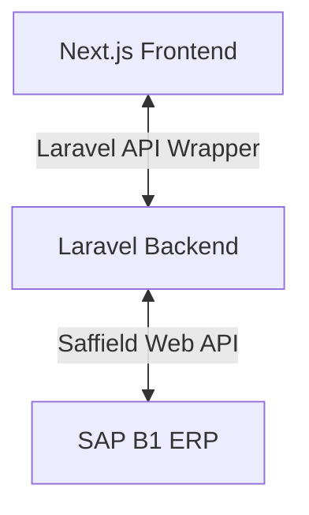

# SAP Integration & Batchwise Stock Management Implementation Plan (Frontend)

This document outlines the frontend implementation requirements for the Next.js React client to support batch-level inventory management and SAP B1 ERP workflows.

## 1. Frontend Architecture & Flow

In the batchwise stock model, the Next.js application communicates with the Laravel backend APIs (which act as the coordinator to SAP B1). The frontend must support user interfaces for stock transfers, GRN confirmations, B2B purchasing, and POS batch allocations.

---

## 2. Frontend Workflows & UI Requirements

### A. Online Checkout (B2C Client Portal)
* **Rule:** Checkout is blocked if any item is out of stock. Near-expiry batches (< 30 days) must not be counted towards B2C stock levels.
* **UI Changes:** 
  * Cart page (`cart/index.tsx`) and Checkout Section (`CheckoutSection.tsx`) must check the real-time stock indicator.
  * If the backend returns `in_stock = false` for any item, disable the checkout button and show a warning toast: `"Please remove out-of-stock items before proceeding."`

### B. Walk-in POS & Cashier Dashboard
* **Rule:** Cashiers at branch stores bill walk-in customers. The backend defaults to FEFO (First Expired, First Out) batch deduction, but cashiers must see which batch is being deducted and have override capabilities if needed.
* **UI Changes:**
  * In the POS billing screen, show the allocated batch numbers and expiry dates next to each added item.
  * Allow cashiers to click a dropdown to select a different available batch if they are physically picking a different bottle/box. (Requires calling backend `/api/stores/variants/{id}/batches` list).

### C. Purchase Order Module (Branch $\rightarrow$ HQ Replenishment)
* **Rule:** Store managers can raise POs to HQ. They must be able to track the lifecycle of the PO (Draft $\rightarrow$ Pending $\rightarrow$ Approved $\rightarrow$ Dispatched/GIT $\rightarrow$ Received).
* **UI Screens:**
  1. **PO Creation Form:** Search products, enter requested quantities, and click "Submit to HQ".
  2. **PO Tracking List:** Display PO numbers (e.g. `PO-2026-0001`), source/destination branches, status tags, and timestamps.
  3. **Goods Received Note (GRN) Confirmation Screen:** When stock physically arrives:
     * Display a checklist of dispatched items, batch numbers, and dispatched quantities.
     * Provide input fields for `received_qty` per batch.
     * Flag discrepancies: If `received_qty < dispatched_qty`, require the user to input a discrepancy note (e.g. `"2 units damaged in transit"`).
     * Submit GRN button: Calls backend `/api/purchase-orders/{id}/receive` which triggers `/api/sap/receive-stock` in SAP.

### D. Store-to-Store Stock Transfer
* **Rule:** Branch managers can request stock from peer stores when HQ is out of stock.
* **UI Screens:**
  1. **Stock Request Form:** Select fulfilling store (exclude HQ), add items/quantities, and submit.
  2. **Incoming Stock Request Dashboard (Fulfilling Store):**
     * Display requested items.
     * Fulfilling store manager reviews, approves, and dispatches.
     * During dispatch, the UI must show a batch selector (populated via `/api/sap/available-batches`) to select which specific batch is being shipped.
  3. **Receiving Screen:** Standard GRN check matching the dispatched batches.

### E. Returns & Quarantine Portal
* **Rule:** Returned items cannot be sold and must go to quarantine.
* **UI Changes:**
  * In the Support / Order returns dashboard, when a return is confirmed:
    * The UI displays a checklist of order items.
    * Support selects the returned items and logs the return reason (e.g. `expired_on_receipt`, `damaged`).
    * The backend automatically moves these units to a local quarantine batch and updates SAP Blocked Stock via `/api/sap/createCreditNote`.

---

## 3. Redux State & API Endpoints

Update Redux slices and SWR/Axios hooks to support the new features:

* **New API Endpoints Mapped on Frontend:**
  * `GET /api/stores/batches?variant_id=...` $\rightarrow$ Lists batches for variant stock selection.
  * `GET /api/purchase-orders` $\rightarrow$ Fetches PO history.
  * `POST /api/purchase-orders` $\rightarrow$ Raises a new PO.
  * `POST /api/purchase-orders/{id}/dispatch` $\rightarrow$ Dispatches a PO (with batch details).
  * `POST /api/purchase-orders/{id}/receive` $\rightarrow$ Confirms GRN.
  * `GET /api/stock-requests` $\rightarrow$ Fetches peer transfers.
